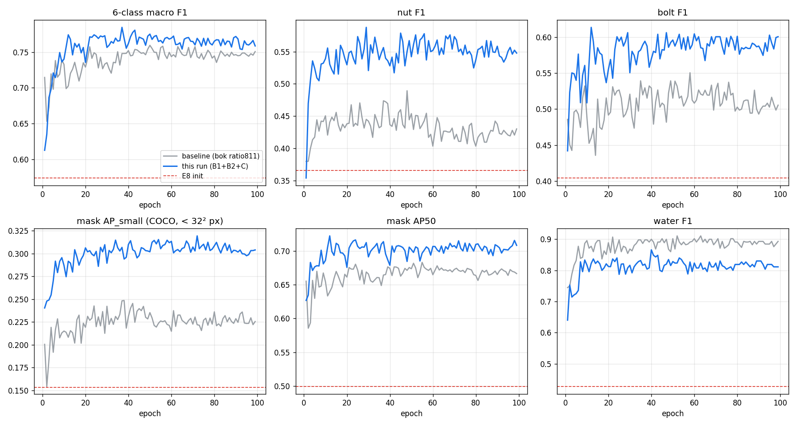

# 아주 작은 마스크(볼트·너트) 인식 개선 재학습 — RTMDet-Ins 6클래스

> **질문:** 바닥 위 볼트·너트처럼 **아주 작은 물체의 마스크 성능이 학습 파이프라인 수정만으로 실제로 오르는가?**
>
> **답 (중간 결과, 100에폭 중 57에폭 기준):** **올랐다.** 같은 데이터·초기 가중치·평가 기준의 기존 학습(baseline)과 같은 에폭끼리 비교하면
> 작은 물체 마스크 **AP_small 0.226 → 0.308 (+36%)**, **nut F1 0.448 → 0.560 (+0.11)**, **bolt F1 0.521 → 0.593 (+0.07)**.
> 반대로 water F1은 0.884 → 0.823으로 내려갔다.



---

## 1. 배경 — 왜 작은 마스크가 안 됐나

산업 현장 바닥의 위험물(액체 4종, 볼트·너트, 반사광)을 IMX219 카메라 영상에서 인스턴스 분할하는 모델이다.
기존 모델은 볼트·너트의 mask AP50이 낮았는데, 원인을 추적한 결과 **데이터나 라벨이 아니라 학습 파이프라인**에 있었다.

| 원인 | 내용 |
|---|---|
| ① 정답 박스 강제 확장 | 학습 시 작은 정답 박스를 최소 **20 px**로 키움 → 작은 물체의 박스가 실제 마스크의 **약 4배** → 붐비는 곳에서 이웃 물체와 겹쳐 인식 저하 |
| ② 정답 마스크 밀림 | mmdet `Resize`가 마스크를 `INTER_NEAREST`로 줄이면서 정답 마스크가 **+0.7 px** 밀림 → 모델이 밀린 위치를 학습. (예측을 사후에 1 px 되돌리기만 해도 bolt+nut AP50 0.309 → 0.392) |
| ③ 밀집 장면 부족 | 이웃 거리 0–20 px의 볼트·너트 인식률 0.21 (40 px 이상은 0.91). 후처리(NMS) 손실은 1–3%뿐이고 원인은 모델 점수 쪽 |

참고: 볼트·너트의 85%가 1024 입력 기준 8 px 미만이라 **해상도 자체의 한계**(IoU 천장 약 0.63)도 있다. 이번 실험은 그 한계 안에서 파이프라인 문제만 고친다.

## 2. 바꾼 것 (세 가지만)

| ID | 변경 | 위치 |
|---|---|---|
| **B1** | 학습용 최소 박스 크기 **20 px → 10 px** | `src/training/train_all6.py` `min_training_box_side` |
| **B2** | 정답 마스크 축소 보간을 면적 기반(`INTER_AREA` ≥ 0.5)으로 바꿔 **0.7 px 밀림 제거** | `src/patches/mask_resize_fix.py` |
| **C** | **밀집 장면 증강** 에폭당 280개 추가 (140장면, 그중 60장면은 액체 위에 금속) | `src/training/all6_sampling.py` (`fastener_crowd`) |

**B1을 0이 아니라 10 px로 둔 이유:** 처음에는 확장을 완전히 끄려고 0으로 뒀다. 그런데 8 px보다 작은 박스 안에는 가장 촘촘한 예측 격자점(stride 8)이 하나도 들어가지 않을 수 있다. 그러면 그 정답은 학습 신호를 받지 못하고, 학습 코드의 검사에 걸려 `Unassigned GT`로 중단됐다. 격자점이 반드시 하나 이상 들어가는 최소값인 10 px로 정했다.

그 외 조건은 baseline과 **모두 같다.**

| 항목 | 값 |
|---|---|
| 모델 | RTMDet-Ins tiny (CSPNeXt deepen 0.167 / widen 0.375), 6클래스 (water, bolt, nut, oil, paint, reflection) |
| 초기 가중치 | 이전 학습의 valid best (E8) — 가중치만, optimizer 새로 |
| 데이터 분할 | train 442 원본 (에폭당 증강 포함 2,180 항목, baseline은 1,900) / valid 55 / test 56 |
| 입력 | 1600 px, BF16 |
| 배치 | 2 × gradient accumulation 2 |
| 학습률 | AdamW 1e-4 → cosine 1e-5, weight decay 0.01, warmup 500 배치 |
| 에폭 | 100, early stopping 없음 |
| best 선택 | valid 6클래스 macro F1 (test는 선택에 쓰지 않음) |
| 평가 | score ≥ 0.5, mask IoU ≥ 0.5 매칭 F1 + COCO mask AP |

## 3. 결과 (valid 55장, 같은 에폭끼리)

아래 표는 [`results/summary_table.md`](results/summary_table.md)에서 가져왔다. 이 표와 위 그래프는 [`tools/make_report.py`](tools/make_report.py)로 만든다.

| 지표 | E8 (시작) | baseline best (ep 50) | **이번 best (ep 37)** | baseline 평균 ep 48–57 | **이번 평균 ep 48–57** |
|---|---|---|---|---|---|
| **mask AP_small** (COCO, < 32² px) | 0.153 | 0.235 | **0.307** | 0.226 | **0.308** |
| **nut F1** | 0.366 | 0.454 | **0.556** | 0.448 | **0.560** |
| **bolt F1** | 0.404 | 0.515 | **0.594** | 0.521 | **0.593** |
| mask AP50 | 0.499 | 0.674 | **0.714** | 0.674 | 0.699 |
| mask mAP | 0.270 | 0.361 | **0.422** | 0.358 | 0.417 |
| mask AP_medium | 0.486 | 0.642 | **0.696** | 0.637 | 0.683 |
| 6클래스 macro F1 | 0.574 | 0.759 | **0.785** | 0.751 | 0.768 |
| water F1 | 0.427 | 0.902 | 0.820 | 0.884 | **0.823 ▼** |
| oil F1 | 0.750 | 0.902 | 0.917 | 0.882 | 0.846 |
| paint F1 | 0.524 | 0.800 | 0.821 | 0.797 | 0.804 |
| reflection F1 | 0.972 | 0.984 | 1.000 | 0.976 | 0.985 |
| 빈 판의 위험물 오검출 / 장 | 0 | 0 | 0 | 0 | 0 |

**해석**
- **작은 물체 지표(AP_small, nut, bolt)는 1에폭부터 끝까지 baseline보다 위에 있다.** 한두 에폭 운이 아니라 곡선 전체가 위로 올라간 모양이다. baseline의 nut F1은 0.38~0.47에서 정체했는데, 이번에는 2에폭에 이미 그 구간을 넘었다.
- **water F1은 약 0.06 내려갔다.** 밀집 장면 중 액체 위에 금속을 붙인 60장면이 액체 경계 학습에 영향을 줬을 가능성이 있다(검증 필요).
- train loss는 baseline보다 낮지만, 박스 목표와 데이터가 달라서 **절대값으로는 비교할 수 없다** ([`results/train_loss.png`](results/train_loss.png)).

**한계 (해석할 때 주의할 점)**
1. **세 변경을 동시에 넣었다.** 어느 변경이 얼마나 기여했는지는 이 실험만으로 나눌 수 없다(개별 ablation 필요).
2. **valid가 55장뿐이다.** 에폭마다 ±0.01~0.02 흔들리는 건 의미가 없다. 그래서 같은 에폭 구간의 평균도 같이 적었다.
3. **valid와 train이 같은 물리 장면을 공유한다**(`physical_scenes_shared: true`). 절대 점수는 실제보다 높게 나온다. 다만 baseline도 조건이 같아서 **두 실행 간 비교는 유효하다.** E8 대비 상승폭은 이 이유로 과대평가돼 있다.
4. 최종 test(56장) 결과와 실기(Jetson Orin Nano) 비교 이미지는 학습이 끝난 뒤 추가한다.

## 4. 학습 중 겪은 문제와 해결 (Windows + WSL2 + RTX 5070 Ti)

| 증상 | 원인 | 해결 |
|---|---|---|
| 시작 2분 만에 `RuntimeError: Unassigned GT` | B1을 0 px로 두자 8 px 미만 박스에 격자점이 하나도 없어 정답이 배정되지 않음 | 최소 박스를 10 px로 |
| 2에폭 중반부터 점점 느려짐 (배치 10개 3.8초 → 78초) | 학습 코드에 GPU 메모리 상한이 없음(원래 메모리 64 GB인 Jetson AGX용) → PyTorch 캐시가 15.9 / 16.3 GB까지 불어남 → Windows 드라이버가 VRAM을 시스템 RAM으로 넘김(sysmem fallback). OOM 오류 없이 느려지기만 함 | `PYTORCH_CUDA_ALLOC_CONF=expandable_segments:True,garbage_collection_threshold:0.6`으로 재개 → VRAM 4.4 GB, 정상 속도 ([`tools/restart_alloc.sh`](tools/restart_alloc.sh)) |
| 28에폭에 `Resource emergency` 중단 | `nvidia-smi`가 GPU 온도를 **184 °C**로 한 번 잘못 읽음(실제 37–53 °C). 안전장치가 한 번의 값으로 중단하는 구조 | 저장 지점(`last.pth`)부터 재개. 2–3회 연속 판정으로 바꾸는 것이 근본 해결 |
| 원격 서버 → 집 PC 27 GB 복사가 70시간 예상 | 인터넷 경로의 패킷 손실로 TCP 연결 하나당 약 95 KB/s(cwnd 1–5, 대량 재전송) | 파일 목록을 24개로 나눠 병렬 rsync → 약 2.3 MB/s, 3.5시간 ([`tools/agx_rsync_par.sh`](tools/agx_rsync_par.sh)) |

속도: RTX 5070 Ti에서 에폭당 약 7.5분(평가 포함). 같은 설정이 Jetson AGX Orin에서는 약 19분이었다. 이미지 로딩 대기가 약 28%라 GPU가 쉬는 구간이 있다.

## 5. 저장소 구성

```
README.md
results/                       집계 수치만 (이미지별 정보 없음)
  valid_curves.png             이번 학습 vs baseline vs E8, 같은 에폭
  train_loss.png
  summary_table.md
  ours_valid_epochs.jsonl      에폭별 valid 집계 지표 (이번 학습)
  bok_ratio811_valid_epochs.jsonl   baseline
  initial_E8_valid.json
src/
  training/                    학습 코드 (baseline 사본 + B1/C 수정, CHANGES.md)
  patches/mask_resize_fix.py   B2
tools/                         환경 설치, 복사·감시·재개 스크립트, 결과 정리 스크립트
images/                        (추가 예정) 실기 비교 이미지
```

**공개하지 않는 것:** 현장 이미지, 데이터셋, 라벨(COCO json), 데이터 분할 목록, 학습된 가중치. 코드 안의 내부 경로, 호스트명, 계정은 일반 경로(`/home/user/...`, `/data/...`)와 `<TRAIN_SERVER>`로 바꿨다. 데이터가 없어서 이 저장소만으로는 학습을 재현할 수 없고, 방법과 결과를 기록하는 것이 목적이다.

## 6. 환경

| | 버전 |
|---|---|
| GPU / 드라이버 | NVIDIA RTX 5070 Ti 16 GB (Blackwell, sm_120) / 616.92 |
| OS | Windows 11 + WSL2 Ubuntu 22.04 |
| CUDA toolkit | 12.8 |
| Python | 3.10 |
| PyTorch | 2.8.0 + cu128 |
| mmcv | 2.1.0 (sm_120용 소스 빌드, [`tools/install.sh`](tools/install.sh)) |
| mmdet / mmengine | 3.3.0 / 0.10.7 |
| 기타 | numpy 1.26.4, opencv-python-headless 4.10, pycocotools 2.0.11 ([`tools/requirements.txt`](tools/requirements.txt)) |

## 7. 출처 · 라이선스

- 외부 라이브러리: [MMDetection](https://github.com/open-mmlab/mmdetection), [MMCV](https://github.com/open-mmlab/mmcv), [MMEngine](https://github.com/open-mmlab/mmengine) (Apache-2.0), [PyTorch](https://github.com/pytorch/pytorch) (BSD-3-Clause), OpenCV (Apache-2.0), pycocotools (BSD-2-Clause).
- 모델 구조: RTMDet ([Lyu et al., 2022](https://arxiv.org/abs/2212.07784)).
